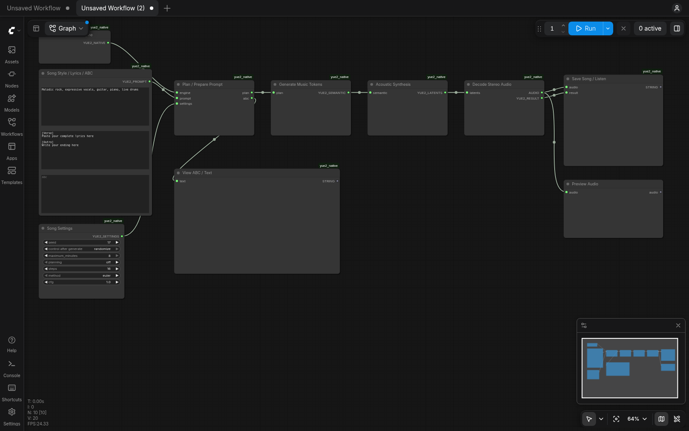

# YuE2 on a standard ComfyUI canvas

Use [YuE2_ComfyUI_Kaggle.ipynb](YuE2_ComfyUI_Kaggle.ipynb). The existing Gradio
notebook remains available as a fallback. Stop the old generator cell before
starting another generator in the same Kaggle GPU session.

1. Import the new notebook into Kaggle.
2. Attach your existing private `yue2-music-assets` dataset once, select GPU T4 x2,
   and enable Internet. The model dataset does not need rebuilding.
3. Run the one code cell. Open **OPEN SONG CANVAS** or **OPEN WAV → ABC CANVAS**.
4. Edit the actual node widgets, then press ComfyUI's **Run** button. Nothing
   renders automatically. Keep the notebook cell running while using the canvas.

The URL loads the connected graph directly. Both graphs are also saved under
ComfyUI's workflow menu as **YuE2 Song** and **YuE2 Cover**; JSON copies live in
[workflows](workflows). There is no branded form or Gradio interface in this mode.

## Song generation

The visible chain is: native engine + style/lyrics/ABC + settings → plan → music
semantic tokens → acoustic synthesis → stereo decoder → save masters / standard
ComfyUI audio preview. These are separate executing stage nodes, not one wrapper
node hiding the old interface. `View ABC / Text` shows a generated score when
planning is enabled. Direct generation remains the default; no score is invented
when planning is off. A full score can also be pasted into the prompt's ABC field.

Settings retain the native FP16/CUDA-graph path and grouped T4 attention patches,
16 Euler steps, CFG 1, eight-minute ceiling and natural end tokens. The solver is
restored from each node's settings before acoustic execution, including cached
branches. Standard Comfy seed controls randomize subsequent queued attempts.
Cancellation is polled by the native stages. Existing model weights and precision
are used; this does not switch back to the older INT8/FP32 Comfy generation path.

Masters are 48 kHz stereo PCM-24 WAV and FLAC. Tokens, planning, latents/checksum,
settings, actual duration, cutoff/end-token status and acoustic boundaries are
retained under `/kaggle/working/yue2_native/runs`. The save node shows status and
folder information, while Preview Audio provides the usual canvas player. A run
ZIP is made when space permits. Download/save desired outputs before the session
ends. A natural end token alone does not prove complete lyrics or musical quality.

### ABC planning limit

`Song Settings → abc_token_limit` now defaults to **4096**, with a range of
128–8192. Earlier canvas code silently capped Full planning at 1200 tokens and
Melody at 800. The uploaded error report confirmed a Full planning cutoff at
exactly 1200 tokens after about 31 seconds on the GPU. That was the planner budget,
not the song-duration ceiling, an OOM, or CPU inference.

For optional generated scores, retain your chosen planning mode and adjust this
separate budget if needed. Higher limits allow a longer score but do not force it
to finish naturally. A cutoff preserves its partial score/settings and status,
then stops before music synthesis; partial notation is never treated as complete.
The model's total context guard remains active. For direct generation with no
score, select `off` and leave ABC empty; that path does not generate ABC.

The field is optional at the node API level so existing workflow JSON without it
still works and receives the 4096 default. Load your own saved workflow after
updating to retain lyrics, Full planning, solver steps and CFG selections. Three
additional CPU checks cover explicit budget forwarding, old settings without the
field, and saved partial scores with early failure. Thirteen canvas tests pass;
actual completion of this user's score with the higher ceiling is unverified.

## Existing WAV to ABC

On the second canvas, use ComfyUI's standard **Load Audio** upload button, then
Run. **Extract Melody ABC** uses the existing SheetSage2/MERT models and displays
the approximate melody notation on the node. No lossy compression is performed:
the uploaded source is retained in Comfy's input folder, with a temporary floating
point WAV working copy used for analysis and removed afterward. Analysis output,
score and ZIP remain under `cover_sources`. This is melody extraction, not a
complete orchestral transcription or exact voice/arrangement preservation.

Copy the resulting ABC to the song prompt's ABC field, select melody planning and
supply your lyrics/style. You can also convert the ABC widget to an input and
connect the extractor's ABC output when editing your own combined graph.

## Runtime isolation and checks

ComfyUI's source is pinned to `bc5f880dbdd43e426077f42ccec53bb577ffee9f`, with its
specified frontend 1.57.1. Its separate environment inherits the native packages
without replacing the existing generator environment; constraints protect the
Kaggle Torch/scientific stack and native dependency pins. New Comfy frontend/server
packages and source require Internet installation on a fresh session. These
packages are not present in the previously saved model dataset. Model loading
continues from that dataset with Hub offline flags. This update does not promise
zero network traffic for the new UI software.

Comfy's controller uses CPU mode so its model manager does not reserve T4 memory.
The existing native pipeline explicitly uses CUDA 0 for the MoT and CUDA 1 for the
VAE, as before. Its Gradio construction is skipped in headless mode; no custom
branding or form is exposed. The old UI's syntax tree is otherwise preserved,
and its original 23 CPU tests passed. Existing source attribution remains.

Cloudflare uses the same checksum-verified executable as the earlier notebook,
with a Comfy-specific health endpoint. It serves normal Comfy HTTP/WebSocket
traffic; no Gradio SSE queue is required. External tunnel failures remain possible.
Startup, server and tunnel logs are under `yue2_native/runtime` in Kaggle output.
Stopping the cell terminates its owned process group and releases its models.

Ten CPU canvas tests passed: actual stage orchestration with a synthetic pipeline,
valid masters/recovery artifacts, natural/cutoff distinction, ABC forwarding,
finite-audio checks, cancellation, lossless cover samples/temporary cleanup,
headless import without Gradio construction, graph structure and source embedding.
A real CPU ComfyUI 0.42.0 server loaded all nodes. Chromium opened both canvases
with zero missing nodes or JavaScript errors, verified the widget defaults, and
exported both API graphs. Real Comfy prompt validation accepted the song graph and
the cover graph with a synthetic WAV selected. No GPU inference, full-song cover
accuracy, seven/eight-minute memory peak or external Cloudflare upload was tested.

Build: `python tools/build_comfy_notebook.py`. Sources: `comfy_yue2/` and
`native_yue2/comfy.py`. The original notebook builder remains separate.
